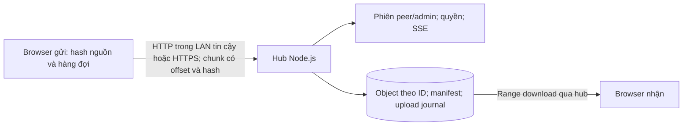
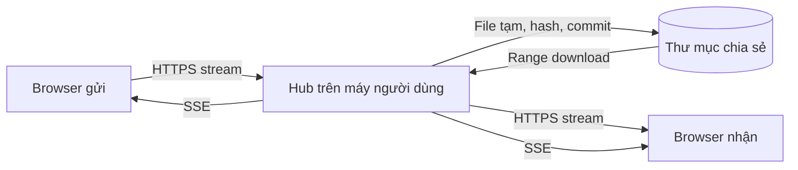
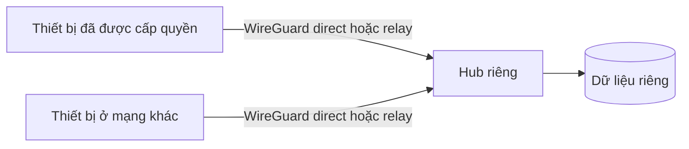
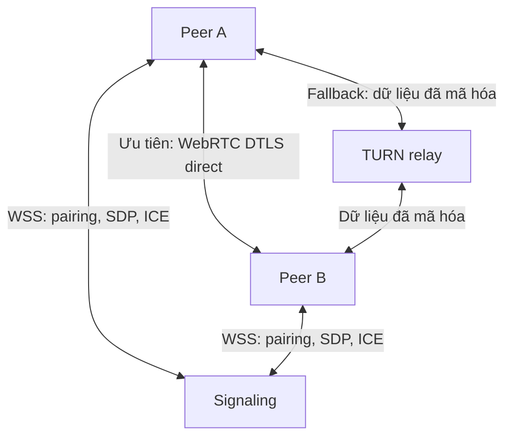

# Kiến trúc truyền tệp riêng tư: LAN và nhiều mạng

> **Cập nhật `0.2.0-alpha.1` — 03-11-2026:** phần từ “Hồ sơ nghiên cứu ban đầu” trở xuống giữ nguyên quan sát trước triển khai. Các dòng source và nhận định “chưa có HTTPS/resume/identity” ở đó đã cũ. Xem [README](../../README.md), [kế hoạch triển khai](../IMPLEMENTATION_PLAN.md), [giao thức thực tế](../PROTOCOL.md) và [bằng chứng xác minh](../VALIDATION.md) cho bản hiện tại.

## Kiến trúc hiện đã triển khai

Giữ Node.js stdlib làm hub, phục vụ UI/API cùng origin. `server.mjs` điều phối HTTP(S), quyền và SSE; `lib/sessions.mjs` quản lý phiên/thiết bị; `lib/file-store.mjs` quản lý payload, quota và recovery. Không thêm dependency npm runtime hoặc transport P2P.

- UI có hàng đợi toàn ứng dụng, tối đa hai file hoạt động; server có giới hạn ghi/hash, quota và số upload dở riêng. Server xác nhận checksum chunk và digest toàn file trước khi đưa file vào danh sách.
- Upload dở có ID, owner, offset và hạn dùng được lưu; resume sau restart cần cookie thiết bị còn hiệu lực và người dùng chọn lại đúng nguồn. API riêng dùng một số ý tưởng offset/HEAD/PATCH; **chưa tương thích tus**.
- Identity hiện là ID thiết bị gắn với token phiên, lưu hash token trên host. Nó giữ quyền sở hữu file qua restart; chưa là keypair thiết bị hoặc pairing fingerprint được xác minh độc lập.
- Peer xóa file do mình gửi; admin có mã riêng, được xóa mọi file và revoke thiết bị. Mọi thành viên vẫn đọc danh sách/file/chat chung. Upload hoàn tất xác nhận host đã commit, chưa xác nhận browser khác đã lưu.
- Có HTTPS cấu hình bằng key/cert ngoài source, kiểm tra Host/Origin và cookie thích hợp. Browser phải tin CA/SAN thật; chưa có tự cấp chứng chỉ, tự pin khóa, auto-discovery hay QR pairing.
- Overlay là cách triển khai được tài liệu hóa; app không tự dựng WireGuard/Tailscale. WebRTC/STUN/TURN, WebTransport/iroh, E2EE, native background và remote control vẫn là nghiên cứu/roadmap.

Các khuyến nghị so sánh transport phía dưới vẫn là tài liệu nghiên cứu ngày 03-11-2026. Tính năng đã có và kết quả kiểm thử cần đọc theo bản alpha ở các liên kết trên; chưa có bằng chứng ở đây để kết luận transport nhanh nhất hoặc tương thích mạng/thiết bị chưa thử.

---

## Hồ sơ nghiên cứu ban đầu — 03-11-2026, trước triển khai

Ngày đối chiếu nguồn: **03-11-2026**, múi giờ Asia/Ho_Chi_Minh. Đây là nghiên cứu và đề xuất kiến trúc; các transport và tính năng được đề xuất dưới đây chưa được triển khai hoặc đo trên thiết bị thật của MCKL Transfer.

## 1. Kết luận để ra quyết định

**Giữ HTTP streaming cho bản LAN; bổ sung độ tin cậy, mã hóa và phân quyền trước. Dùng mạng riêng WireGuard/Tailscale cho nhu cầu khác mạng của một vài người. Chỉ bổ sung WebRTC khi thực sự cần hai trình duyệt gửi trực tiếp mà không cài VPN.**

WebTransport/QUIC là lựa chọn đáng thử nghiệm hiện nay, nhưng không có bằng chứng rằng thay HTTP bằng chúng sẽ làm MCKL Transfer nhanh hơn trên phần cứng và Wi-Fi của người dùng. Việc chọn transport cần theo topology, khả năng trình duyệt, mức tin cậy máy chủ và kết quả đo.

Ba nhu cầu cần tách biệt:

| Nhu cầu | Kiến trúc phù hợp | Đánh đổi |
|---|---|---|
| Một máy nhận/lưu file; các thiết bị mở browser | Hub HTTP(S) trong LAN | Máy hub đọc được file và chat, phải luôn hoạt động |
| Một người/vài người đã biết nhau, ở nhiều mạng | Hub qua mạng riêng được kiểm soát quyền truy cập | Cài VPN trên thiết bị; có thể phải đi qua relay |
| Hai browser ở bất kỳ đâu, không cài VPN | Signaling + WebRTC DataChannel + STUN/TURN | Thêm hạ tầng, pairing, xử lý browser lifecycle và chi phí relay |

Đây là khuyến nghị cho dự án hiện tại, không phải khẳng định một kiến trúc luôn tốt nhất cho mọi ứng dụng chia sẻ file.

## 2. Đọc mã nguồn hiện tại

Những quan sát từ `server.mjs` và `public/app.js` khi kiểm tra:

- Máy chạy Node.js là điểm lưu trữ trung tâm. Browser gửi body `File` lên `/api/upload`; server ghi `.part`, tính SHA-256 rồi rename. Browser khác tải lại từ máy chủ. Vì vậy luồng A → B → C có hai chặng truyền khi B là hub và C mới là người nhận cuối.
- Payload được đọc/ghi theo stream; có backpressure, không đọc toàn bộ file vào RAM. Download có `Range`, ETag và `Content-Length`.
- Upload phía giao diện đang có tối đa **hai worker** cho mỗi lần chọn file. Giới hạn này không phải quota đồng thời toàn server; nhiều browser/lần chọn vẫn có thể tạo thêm upload.
- Server tạo bằng `http.createServer`. PIN/cookie không mã hóa đường truyền. Hash do server tính chưa phải xác nhận độc lập rằng file nhận được giống file gốc phía gửi.
- Chat và thông báo SSE đi qua hub. Mô hình hiện tại không cung cấp mã hóa đầu cuối giữa hai browser, danh tính thiết bị dài hạn hay phòng chia sẻ có phân quyền độc lập.
- `Range` ở download không đồng nghĩa upload đã có resume. Cần một giao thức/session upload có offset được lưu bền vững.

Các nhận xét này là bằng chứng từ bản mã nguồn trong workspace, không phải kết quả benchmark LAN.

## 3. Tách sáu trách nhiệm trước khi thêm transport

| Lớp | Trả lời câu hỏi | Thiết kế đề xuất |
|---|---|---|
| Discovery | Thiết bị đang ở đâu? | URL/QR là fallback; mDNS/DNS-SD trên native/helper; không đưa bí mật vào quảng bá |
| Rendezvous/signaling | Hai đầu trao đổi địa chỉ và tham số thế nào? | Local hub, dịch vụ HTTPS/WSS hoặc overlay; không mặc nhiên chở payload |
| Identity/pairing | Có đúng thiết bị mong muốn? | Danh tính khóa dài hạn, xác minh khi ghép đôi, có thu hồi; QR/invite ngắn hạn |
| Authorization | Thiết bị này được làm gì? | Quyền gửi/nhận/xóa riêng; phạm vi người nhận/phòng/file; hết hạn và quota |
| Data plane | Byte đi trực tiếp hay qua máy khác? | HTTP(S), WebRTC hoặc QUIC; hiển thị đường đi thật và trạng thái relay |
| Storage/recovery | File tồn tại ở đâu và phục hồi ra sao? | Streaming, offset/checksum, file tạm, commit nguyên tử, TTL, dọn quota |

Mã hóa đường truyền, xác thực thiết bị và quyền truy cập là ba yêu cầu riêng. Một kết nối được mã hóa vẫn có thể kết nối nhầm thiết bị; một thiết bị được ghép đôi vẫn không nên có quyền xóa mọi file.

## 4. Các hệ thống và chuẩn nên học

### 4.1 LocalSend: LAN native và HTTP(S) thực dụng

Protocol chính thức đang trình bày **v2.2**: discovery UDP multicast với HTTP fallback; receiver chạy HTTP server; có bước chuẩn bị metadata để nhận/chấp nhận một phần/từ chối, upload binary và reverse download. Fingerprint HTTPS được lấy từ SHA-256 chứng chỉ. Chỉ nhận fingerprint qua discovery chưa đủ xác minh danh tính chống kẻ giả mạo. [LocalSend protocol](https://github.com/localsend/protocol)

Changelog có mã lỗi khi checksum upload không khớp. Repository cũng có sơ đồ `v3` về WebRTC/pairing; sự tồn tại của sơ đồ không chứng minh toàn bộ protocol v3 đã ổn định hoặc được phát hành trong app. [Changelog](https://github.com/localsend/protocol/blob/main/CHANGELOG.md), [sơ đồ v3](https://github.com/localsend/protocol/blob/main/v3/webrtc-diagram.mermaid)

**Áp dụng cho MCKL:** học bước “offer → accept → transfer → verify”, quyền nhận rõ ràng và fallback thủ công. Chỉ quảng bá tương thích LocalSend sau khi triển khai và kiểm thử đầy đủ protocol; thêm multicast của LocalSend đơn lẻ chưa tạo khả năng tương thích.

### 4.2 Syncthing: đồng bộ tin cậy và nhận dạng thiết bị

Syncthing dùng TLS và đối chiếu fingerprint chứng chỉ với danh sách thiết bị được chấp nhận. Global discovery ánh xạ Device ID với IP; local discovery phát thông tin trong LAN. Discovery có thể lộ metadata dù payload đã mã hóa. [Security Principles](https://docs.syncthing.net/users/security.html)

BEP mô tả mô hình file cùng block hashes; đây là nền tảng của đồng bộ theo phần thay đổi, khác với một phiên gửi file tức thời. [Block Exchange Protocol](https://docs.syncthing.net/specs/bep-v1.html)

Relay giúp nối được hai đầu khi direct thất bại, nhưng tài liệu cảnh báo tốc độ thấp hơn direct. [Relaying](https://docs.syncthing.net/users/relaying.html)

**Áp dụng cho MCKL:** học danh tính thiết bị, resume, xác nhận và state machine. Chỉ thêm đồng bộ thư mục khi đã có chính sách conflict, versioning và phục hồi xóa nhầm. App Android chính thức đã dừng và repository được archive ngày 03-12-2024; không hứa một trải nghiệm mobile đồng nhất chỉ vì engine đa nền tảng. [Thông báo của maintainer](https://forum.syncthing.net/t/discontinuing-syncthing-android/23002), [repository Android](https://github.com/syncthing/syncthing-android/releases)

### 4.3 PairDrop/WebRTC: hai browser và NAT traversal

PairDrop dùng WebRTC, pairing/room và TURN cho một số kết nối khác mạng; có thể tự host STUN/TURN. FAQ phân biệt signaling với đường truyền file, đồng thời nêu vẫn phải tin server cung cấp ứng dụng/signaling. [PairDrop](https://github.com/schlagmichdoch/PairDrop), [FAQ kỹ thuật và bảo mật](https://github.com/schlagmichdoch/PairDrop/blob/master/docs/faq.md)

WebRTC không quy định dịch vụ signaling; ứng dụng phải trao đổi SDP/ICE qua một kênh khác. STUN hỗ trợ tìm địa chỉ kết nối; TURN chuyển tiếp dữ liệu khi không nối trực tiếp được. [WebRTC peer connections](https://webrtc.org/getting-started/peer-connections)

DataChannel là SCTP trên DTLS/ICE, không phải một socket TCP đơn giản. Có lựa chọn reliable/unreliable; truyền file cần bảo đảm giao đủ dữ liệu hoặc tự xây cơ chế phục hồi. [RFC 8831](https://www.rfc-editor.org/rfc/rfc8831.html)

Giới hạn message cần được thương lượng; MDN ghi mặc định 64 KiB khi SDP thiếu `max-message-size`. Message lớn có thể gây chặn các message khác. [MDN DataChannel, cập nhật 22-06-2026](https://developer.mozilla.org/en-US/docs/Web/API/WebRTC_API/Using_data_channels)

Sender cần chặn hàng đợi bằng `bufferedAmount` và tiếp tục khi `bufferedamountlow`, thay vì đọc/gửi cả file liên tục. [MDN bufferedAmount](https://developer.mozilla.org/en-US/docs/Web/API/RTCDataChannel/bufferedAmount)

**Áp dụng cho MCKL:** thử nghiệm reliable DataChannel, chunk nhỏ có số thứ tự, backpressure và xác nhận hoàn tất. Chunk 16–64 KiB là miền thử ban đầu của dự án, phải nằm trong khả năng hai đầu; đây không phải một kích thước “nhanh nhất”. Không dùng datagram mất gói cho payload file nếu chưa có giao thức sửa mất dữ liệu.

### 4.4 QUIC, HTTP/3 và WebTransport: đáng thử, cần phân biệt

QUIC cung cấp nhiều stream, flow control, thiết lập kết nối và migration; giảm chặn giữa các stream khi mất gói, nhưng stream chứa dữ liệu bị mất vẫn cần retransmission. Điều đó không bảo đảm thông lượng một file đơn cao hơn TCP. [RFC 9000](https://www.rfc-editor.org/rfc/rfc9000.html)

HTTP/3 ánh xạ HTTP lên QUIC. Đây là thay đổi transport dưới HTTP, không tự tạo discovery hoặc NAT traversal cho ứng dụng. [RFC 9114](https://www.rfc-editor.org/rfc/rfc9114.html)

**Cập nhật đáng chú ý:** MDN ghi WebTransport đạt **Baseline 2026**, khả dụng trên các browser mới từ tháng 03-2026; thiết bị cũ vẫn có thể thiếu hỗ trợ. API cho browser kết nối tới HTTP/3 server, có reliable streams/unreliable datagrams và yêu cầu secure context. [MDN WebTransport](https://developer.mozilla.org/en-US/docs/Web/API/WebTransport)

**Áp dụng cho MCKL:** không dùng kết luận cũ “WebTransport chỉ dành cho Chromium”. Feature detection và kiểm thử đúng Safari/Chrome/Firefox mục tiêu vẫn bắt buộc. Thử nghiệm WebTransport ở nhánh riêng khi HTTP đã được đo; duy trì HTTP fallback. Nó không thay thế WebRTC cho hai browser muốn tự xuyên NAT.

### 4.5 iroh: hướng native QUIC có identity và relay

Tài liệu iroh được truy cập hiển thị bản **1.4.1**: thư viện Rust hỗ trợ QUIC P2P, hole punching và relay fallback. Khóa công khai xác định peer; relay chỉ chuyển lưu lượng mã hóa. Ứng dụng vẫn phải quyết định peer nào được phép truy cập. [Tài liệu crate iroh](https://docs.rs/iroh/latest/iroh/)

**Áp dụng cho MCKL:** là ứng viên thử nghiệm nếu cần native agent cho desktop/mobile và muốn tránh tự viết NAT traversal. Chưa có lý do để thay server Node đang hoạt động chỉ vì thư viện này dùng Rust/QUIC. Cần đánh giá packaging, binding, browser interop, license dependency và vận hành relay trước.

### 4.6 Tailscale/WireGuard: đường ngắn cho nhóm riêng

Tài liệu Tailscale xác nhận ba đường truyền: direct UDP, Peer Relay và DERP. Cả ba mã hóa WireGuard đầu cuối ở lớp overlay; direct thường có latency thấp và throughput cao hơn. Kiểm tra bằng `tailscale status`/`tailscale ping`; không suy ra direct chỉ từ địa chỉ `100.x`. [Connection types, xác nhận 01-06-2026](https://tailscale.com/docs/reference/connection-types)

Peer Relay cho phép dùng thiết bị trong tailnet làm relay khi direct thất bại; nó vẫn thêm một hop và cần máy relay đủ băng thông. [Peer Relays, xác nhận 04-02-2026](https://tailscale.com/docs/features/peer-relay)

**Áp dụng cho MCKL:** hỗ trợ cấu hình endpoint riêng, quyền truy cập đúng thiết bị/cổng và hiển thị chẩn đoán mạng. Không mở port-forward HTTP trên router để giải quyết khác mạng. Overlay mã hóa giữa thiết bị và hub; nó không biến hub thành nơi không đọc được file/chat.

## 5. Các giới hạn browser phải giải quyết ngay trong thiết kế

### HTTPS LAN không chỉ là tạo chứng chỉ tự ký

`http://localhost` có ngoại lệ secure context; địa chỉ HTTP của một máy khác trong LAN không có ngoại lệ đó. Service worker yêu cầu secure context. Vì vậy có manifest/SW chưa chứng minh PWA hoạt động đầy đủ khi mở bằng IP LAN. [MDN Secure Contexts, cập nhật 14-09-2026](https://developer.mozilla.org/en-US/docs/Web/Security/Defenses/Secure_Contexts)

**Đề xuất:** dùng HTTPS với chứng chỉ được thiết bị tin cậy và hostname ổn định; hoặc native/helper có khả năng xác thực khóa/chứng chỉ được thiết kế rõ. Không hướng dẫn người dùng bỏ qua cảnh báo TLS như giải pháp pairing. Trong browser thông thường, ứng dụng web không có toàn quyền tự pin chứng chỉ TLS của một server tùy ý như native client.

### Không thiết kế website công khai tự do quét LAN

Chrome triển khai Local Network Access permission, dùng quyền người dùng thay cho thiết kế PNA preflight cũ. Kết nối từ web công khai/intranet sang địa chỉ riêng hoặc loopback phải xét secure context, user gesture, CORS và quyền tương ứng. [Chrome Local Network Access](https://developer.chrome.com/docs/modern-web-guidance/guides/security/local-network-access)

**Đề xuất:** bản LAN tiếp tục phục vụ UI/API cùng origin từ hub, cung cấp URL/QR; browser không có API Bonjour browsing tổng quát để thay native discovery. Nếu thêm public website nối tới local companion, xây luồng xin quyền và fallback cụ thể; kiểm tra thực tế từng browser.

### Native discovery và chạy nền là công việc riêng

mDNS phục vụ phân giải trên local link; không tự vượt router/VLAN/NAT. [RFC 6762](https://www.rfc-editor.org/rfc/rfc6762.html)

App native Apple cần khai báo mô tả quyền mạng nội bộ; Bonjour cần danh sách service types. Raw multicast/broadcast trên iOS có yêu cầu entitlement. Không đánh đồng yêu cầu của app native với Safari. [Apple TN3179](https://developer.apple.com/documentation/technotes/tn3179-understanding-local-network-privacy)

`URLSession` background chỉ hỗ trợ HTTP/HTTPS; upload chạy nền phải từ file, không từ data/stream tùy ý. [Apple Background Transfers](https://developer.apple.com/documentation/foundation/downloading-files-in-the-background)

**Đề xuất:** cam kết foreground cho bản browser đến khi kiểm thử được nền/khóa màn hình. Nếu gửi file lớn khi khóa iPhone là yêu cầu cốt lõi, làm native integration và kiểm thử trên thiết bị thật; gói webview đơn thuần chưa chứng minh giải quyết được.

## 6. Lộ trình kiến trúc có thể triển khai

### Giai đoạn A — Bản LAN công khai có phạm vi rõ ràng

Thứ tự đề xuất:

1. Đóng các lỗi rò dữ liệu/phân quyền và có quota file, tổng dung lượng, session và upload đồng thời.
2. HTTPS với quy trình trust khả thi; giao diện nói rõ hub có thể đọc dữ liệu, thiết bị đã đăng nhập được truy cập phạm vi nào.
3. Transfer session có `id`, owner, expected length, offset, trạng thái và thời hạn; resume sau mất mạng/restart; cancel và dọn file dở.
4. Client/server xác minh checksum đã thỏa thuận; chỉ báo thành công sau khi server commit và receiver xác nhận theo mô hình sản phẩm.
5. Giữ streaming, giới hạn bộ nhớ, concurrency có giới hạn và đo với hai thiết bị thật.
6. QR/URL trước; native/helper discovery sau. Fallback cho multicast bị chặn, guest Wi-Fi/client isolation, nhiều NIC và IPv6.

Có thể dùng chuẩn **tus** cho resume: HEAD lấy offset, PATCH nối dữ liệu, có extension checksum, expiration và termination. Đây là giao thức phục hồi upload, không thay transport và không tự cung cấp E2EE/quyền truy cập. [tus protocol](https://tus.io/protocols/resumable-upload)

### Giai đoạn B — Nhóm riêng dùng khác mạng

Giữ cùng API; chạy hub qua overlay với chính sách chỉ cho thiết bị/người cần dùng truy cập service. Duy trì xác thực ứng dụng và quyền gửi/nhận/xóa. Có TTL và thu hồi thiết bị. Chẩn đoán riêng direct/relay, DNS, reachable port và hết dung lượng. Chọn một hub/NAS đủ ổn định nếu cần nhận file lúc người nhận đang offline.

Đường đi này phù hợp giả định một/vài người biết nhau và chấp nhận cài VPN. Không xem đây là giải pháp cho người lạ nhận link công khai mà không cài thêm gì.

### Giai đoạn C — P2P tùy chọn cho người không cài VPN

Thiết kế ứng dụng đề xuất:

- Chỉ tạo phiên khi có invite hết hạn; không danh bạ mọi thiết bị theo chung IP công khai.
- Xác thực pairing và identity bằng cơ chế được review, ràng buộc peer key/fingerprint vào phiên. QR có entropy cao; mã ngắn cần giới hạn thử và giao thức pairing phù hợp, không tự thiết kế crypto.
- Kiểm soát quyền ở peer nhận trước khi gửi payload; consent theo phiên/file; có revoke và timeout.
- Reliable channel cho file, control channel riêng; backpressure, chunk/offset/checksum và metadata cần thiết.
- UI báo “direct” hoặc “relay”, tên peer đã xác minh, byte đã receiver xác nhận. Không dùng phần trăm `send()` đã queue để nói đã nhận xong.
- TURN có credential ngắn hạn, quota/băng thông/giới hạn phiên; không mở relay vô danh cho mọi người.
- Browser nhận file lớn cần đích lưu có streaming phù hợp; tránh gom mọi chunk thành một Blob trong RAM. Cần kiểm thử và fallback theo capability của browser.
- Giữ hub HTTP làm fallback/nhận offline. Nếu hub/cloud không được tin cậy, mã hóa cho public key của người nhận trước khi lưu; phải thiết kế thêm quản lý khóa, metadata và recovery.

Nếu native trở thành nhu cầu chính, thử iroh/QUIC theo giao diện transport chung. Không triển khai song song mọi transport ngay từ đầu.

## 7. Tốc độ: các giả thuyết phải đo

**Không có số đo trong nghiên cứu này chứng minh tốc độ thực LAN hoặc transport nào nhanh nhất cho MCKL.** Các thử nghiệm nên gồm:

| Thử nghiệm | Lý do | Dấu hiệu để quyết định |
|---|---|---|
| HTTP(S) direct tới hub; HTTP qua overlay direct; overlay relay | Tách protocol khỏi topology | Goodput, RTT và đường đi xác nhận |
| Một file lớn; nhiều file nhỏ; hai người cùng gửi | Tách throughput khỏi overhead/fairness | Thời gian toàn phiên, p95, starvation |
| Concurrency 1/2/4; chunk và buffer khác nhau | Tránh tăng song song vô hạn | Throughput tăng thực, RAM/CPU và UI vẫn ổn |
| Hub lưu SSD so với thiết bị nhận trực tiếp | Tách disk I/O khỏi network | Disk utilization, hash CPU và tổng byte qua mạng |
| Mất mạng rồi nối lại, đổi Wi-Fi, restart hub | Đo hiệu quả resume | Byte phải gửi lại, khôi phục đúng checksum |
| Safari iPhone thật, khóa màn hình/thay app | Kiểm chứng lifecycle | Có tiếp tục, dừng có báo, resume có hoạt động |

Ghi tốc độ bằng **payload đã hoàn tất / thời gian thực**, kèm MiB/s và Mbit/s rõ đơn vị. 1 Gbit/s tương đương trần số học 125 MB/s trước overhead; Wi-Fi quảng cáo link rate không phải throughput ứng dụng. So sánh cùng file, đường mạng, thiết bị và hash; lặp đủ lần để thấy biến động. Không giảm mã hóa/kiểm tra toàn vẹn chỉ để tạo số đẹp.

Ưu tiên bỏ một chặng hub khi người nhận cuối là thiết bị khác và cả hai online; tuy nhiên direct browser-to-browser cần được so với hiệu năng disk/hệ thống hiện tại. Với vài người, mô hình hub có thể đơn giản, bền và đủ nhanh hơn đáng kể so với giá trị của việc tự vận hành signaling/TURN.

## 8. Remote nên nằm ở ranh giới nào?

Tách “truy cập tệp từ xa”, “xem màn hình” và “điều khiển máy” thành ba capability khác nhau. Truy cập tệp từ xa đã có thể đáp ứng bằng giai đoạn B. Nếu thêm xem màn hình/điều khiển, sử dụng module native hoặc tích hợp công cụ chuyên dụng với quyền và xác nhận riêng; không mở terminal/execute-command chỉ vì người đó biết PIN gửi file.

Thiết kế remote cần một phiên có người cho phép, chỉ báo đang hoạt động, nút ngắt tại máy được điều khiển, danh tính đã ghép đôi, giới hạn quyền clipboard/file/input và log không ghi nội dung nhạy cảm. Nếu cần unattended access, đó là một mô hình tin cậy khác, cần thiết kế riêng trước khi phát hành.

## 9. Những điều chưa được xác minh

- Chưa đo thông lượng giữa hai máy, Wi-Fi 5/6/6E/7, Ethernet 1/2.5/10 GbE hoặc iPhone thật.
- Chưa triển khai/chạy thử HTTPS LAN, LocalSend compatibility, WebRTC/TURN, WebTransport, iroh hoặc VPN trong workspace này.
- Baseline của API không chứng minh mọi tính năng phụ hoặc phiên bản thiết bị cũ đều hoạt động.
- Tài liệu dịch vụ và thư viện tiếp tục thay đổi. Chốt lại phiên bản, browser matrix và tài liệu gốc lúc triển khai.

Các sơ đồ và lộ trình là thiết kế đề xuất dựa trên nhu cầu và hiện trạng mã nguồn; không mô tả tính năng đã có của MCKL Transfer.
