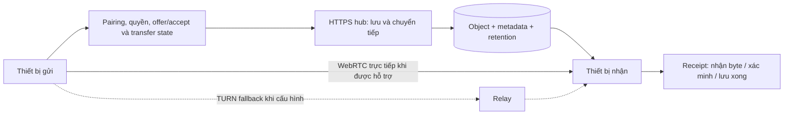

# MCKLTransfer — Deep Audit và kế hoạch nâng cấp

Ngày: **06-11-2026**, Asia/Ho_Chi_Minh. Snapshot: **`4a7a609c89ba97fd540ccac65108773748472e17`**, `0.2.0-alpha.2`. Báo cáo này bổ sung nghiên cứu ngày 03-11; không thay thế hồ sơ phát hành cũ.

## 1. Kết luận và định hướng sản phẩm

**Có dư địa nâng cấp đáng kể. Ưu tiên đúng là độ tin cậy → hiệu năng có số đo → trải nghiệm ghép đôi/gửi đúng người → truyền trực tiếp khi phù hợp.**

Định vị đề xuất: **công cụ chuyển dữ liệu riêng tư cho cá nhân/nhóm nhỏ, mở bằng browser là dùng; gửi trực tiếp khi hai đầu online, lưu trên hub khi người nhận offline; luôn cho biết dữ liệu đi đâu và ai đọc được.** Đây là cơ hội khác biệt, chưa phải kết luận đã vượt LocalSend/PairDrop/Syncthing về tốc độ hay độ tin cậy.

Ba lợi thế hiện có nên giữ:

- Client browser không bắt buộc cài app; hub tự quản, không cần tài khoản cloud của MCKL.
- Streaming có backpressure, upload có checksum/resume, Range download, giới hạn byte/quota và phân quyền xóa. Không gom toàn bộ file lớn vào RAM host.
- Runtime Node stdlib nhỏ, test và source exporter có kiểm tra; app VI/EN và README đa ngôn ngữ đã có.

Ba điểm tạo khác biệt thực tế:

1. **Chuyển file đáng tin:** mất phản hồi, đổi mạng, restart, nhiều tab không tạo file trùng hoặc báo trạng thái sai.
2. **Tốc độ minh bạch:** tối ưu hash/chunk/disk; hiển thị tốc độ end-to-end, direct/relay/hub và nút thắt; có benchmark cùng điều kiện.
3. **Gửi đúng người, nhận có kiểm soát:** QR/invite ngắn hạn, inbox/room, chấp nhận nhận, expiry, lịch sử và receipt có ý nghĩa chính xác.

## 2. Phạm vi và bằng chứng

Đã đọc server, storage, session, client, worker hash, service worker, protocol, CI, test và nghiên cứu trước. Ba hướng audit độc lập tập trung vào correctness/performance, protocol và product/security. Tình huống phá vỡ được thử bằng dữ liệu tổng hợp, không dùng file riêng trong thư mục chia sẻ.

| Kiểm tra ngày 06-11 | Kết quả và phạm vi |
|---|---|
| Full suite, Node **26.13.0**, macOS ARM64 | **92/92 pass**, 0 skip, khoảng 8.94 s. Lần đầu bị sandbox chặn socket; chạy lại với loopback được phép đã đạt. |
| Source/syntax check sau khi thêm báo cáo | Pass; **55 source files, 22 JavaScript files**; 14 local Markdown links hợp lệ. Đây là allowlist/pattern check, không phải full secret/PII audit mới. |
| Fault injection bổ sung | Sáu hành vi có bằng chứng ở phần 3; chưa sửa runtime trong đợt nghiên cứu này. |
| Benchmark | HTTP loopback, Node client + host riêng process, random **256 MiB/file × 5 runs**; mọi digest khớp; payload thử đã dọn. |
| Nguồn bên ngoài | Đọc lại tài liệu chính thức/source của LocalSend, PairDrop, Syncthing, MDN, WebRTC, IETF RFC, tus, iroh, Tailscale, Apple và OWASP; nguồn ở phần 10. |

Không có phép đo LAN/Wi-Fi/overlay mới trên hai thiết bị trong lần này. Test logic client qua harness thực thi code thật nhưng dùng transport mô phỏng không phải kiểm thử trình duyệt/điện thoại thật. Không có cơ sở để chứng nhận “an toàn tuyệt đối” hoặc “nhanh nhất”.

## 3. Những điểm audit cần xử lý

P1 = nên xử lý trước khi mở rộng nhóm người dùng/tính năng; P2 = củng cố semantics và độ bền. Không phát hiện P0 đã được chứng minh trong phạm vi kiểm tra này; điều đó không chứng minh toàn bộ hệ thống không có lỗi nghiêm trọng.

| ID | Ưu tiên | Bằng chứng quan sát | Hướng xử lý |
|---|---|---|---|
| A1 | P1 | **Danh sách file cũ sau reconnect.** Harness thực thi `client.js`: trong lúc SSE đứt, server có thêm 1 file; reconnect xong UI vẫn 0, số GET `/api/files` giữ 1→1. Event file tiếp theo mới làm UI cập nhật. | Đồng bộ snapshot files/messages khi SSE `ready`, đóng khoảng trống giữa snapshot và subscribe; dùng revision/sequence nếu cần. Không cần xây event store phức tạp để sửa bước đầu. |
| A2 | P1 | **Mất response `/complete` → Retry upload trùng.** Server đã có 1 file; client thấy lỗi. Bấm handler Retry thật trong harness làm số completed files và create calls tăng từ 1 lên 2. Gọi complete lần hai trực tiếp trả `404 UPLOAD_NOT_FOUND` dù file đã tồn tại. | Terminal transfer status và complete idempotent theo transfer ID + owner; retry trả cùng kết quả, không tạo upload mới. Terminal record phải có retention/quyền rõ, không hồi sinh file đã bị xóa. |
| A3 | P1 | **Hai host cùng `SHARE_DIR` ghi đè manifest của nhau.** Hai store cùng thư mục đều init; A ghi file thứ nhất, B ghi file thứ hai; manifest cuối chỉ có ID của B. Payload A còn nhưng mất index. | Khóa single-writer ngay startup; process thứ hai phải từ chối trước mutation. Xử lý stale lock/PID reuse/Windows; không dùng kiểm tra `exists` rồi tạo file như một khóa an toàn. |
| A4 | P1 | **Quota byte chưa giới hạn metadata.** Store đặt max total/file size = 0 vẫn nhận và complete được 3 file 0 byte; used bytes vẫn 0. Code không có trần số file hoàn tất, manifest và danh sách UI tăng theo N. | `MAX_FILES`, quota/count theo owner/room, mutation rate limits, giới hạn pending và download đồng thời; pagination. Thiết kế trước khi thêm folder/batch. |
| A5 | P2 | **Revoke không dừng request đang chạy.** HTTP thật: revoke=200, request mới=401; legacy upload đã bắt đầu vẫn complete=201. Download 16 MiB đã bắt đầu vẫn nhận đủ và đúng hash sau revoke. | Nếu muốn “ngắt ngay”: registry AbortController/stream theo session, abort khi revoke/expiry, kiểm tra quyền trước commit. Byte đã gửi không thể thu hồi. |
| A6 | P2 | **Revoke lỗi ghi đĩa có thể mất hiệu lực sau restart.** Inject EIO vào ghi device journal: revoke ném lỗi, live process từ chối token; init lại từ journal cũ thì token hợp lệ trở lại. | Durable revocation journal/transaction và trạng thái storage degraded; không báo revoke thành công trước khi durable. Quy trình xử lý lỗi phải fail closed theo threat model. |

### Vị trí source và cách đọc đúng mức độ nghiêm trọng

- A1: [client.js](../../public/client.js), `connectEvents`, dòng 568–584; [server.mjs](../../server.mjs), `broadcast/openEvents`, dòng 153–215. SSE không có ID/replay. Refresh **sau khi connection ready** cần chống response cũ ghi đè snapshot mới.
- A2: [client.js](../../public/client.js), dòng 495–528; [file-store.mjs](../../lib/file-store.mjs), `commit/complete`, dòng 485–524. [Protocol](../PROTOCOL.md) đã công khai completion chưa idempotent; đây là nâng cấp quan trọng cho UX và reliability, không phải phát hiện hành vi bị che giấu.
- A3: [file-store.mjs](../../lib/file-store.mjs), queue dòng 124, `saveFiles` dòng 168, `init` dòng 256. README đã cấm hai process cùng data directory; khóa giúp ngăn sai thao tác, không mở rộng hỗ trợ multi-writer bằng một lock đơn giản.
- A4: [file-store.mjs](../../lib/file-store.mjs), `usage/checkReservation`, dòng 197–215; [server.mjs](../../server.mjs), `/api/files` dòng 290; [client.js](../../public/client.js), `renderFiles` dòng 158. Ba file chỉ chứng minh byte quota không chặn count; không thực hiện flood lớn. OWASP API4 khuyến cáo giới hạn resource/page/request [S10].
- A5: [server.mjs](../../server.mjs), `requireSession` dòng 188, `download` dòng 218, route auth dòng 274. Protocol hiện chỉ hứa chặn request tiếp theo và SSE; phải quyết định semantics mạnh hơn trước khi đổi implementation.
- A6: [sessions.mjs](../../lib/sessions.mjs), `persist` dòng 35, revoke dòng 110–124. UI/API báo lỗi khi persistence thất bại; không gọi đây là một revoke báo thành công mà âm thầm thất bại. Đây là tình huống disk/permission failure.

### Khoảng trống bổ sung từ code, chưa tái hiện toàn bộ

- **Cross-tab resume**: localStorage/cookie chia sẻ, chưa có server lease/claim theo tab; đã ghi giới hạn một tab trong protocol. Web Locks/BroadcastChannel có thể phối hợp trong browser, nhưng cần server-side lease để bảo vệ cả browser/process khác; feature-detect vì HTTP LAN không phải secure context.
- **Đổi IP/Wi-Fi**: `allowedHosts` chụp interface khi startup; IP mới có thể bị từ chối. Dùng hostname ổn định, cập nhật allowlist theo interface thực có kiểm soát; không đổi sang wildcard.
- **Cancel chưa xác nhận**: `removeUpload` coi 401 như đã dọn rồi quên ID. Trên server, partial có thể còn đến TTL. UI cần phân biệt “đã ngừng gửi” và “host xác nhận xóa”.
- **Download/resource fairness**: mỗi download tạo read stream với `highWaterMark` 1 MiB; chưa có global/per-device cap, per-owner reserved-byte quota. Một thành viên có thể chiếm toàn pending capacity hoặc nhiều stream.
- **Durability/repair**: metadata temp có fsync nhưng parent directory chưa được fsync; device journal chưa fsync. Cần phân biệt crash recovery, durable acknowledgment và power-loss guarantees theo filesystem/OS. Thêm schema version, backup/restore và read-only scrub/repair plan.
- **Integrity ở máy nhận**: UI tải bằng link download; không tự hash lại file OS đã lưu. Host commit không đồng nghĩa người nhận đã lưu thành công.
- **Local mutation cùng kích thước**: `open` xác minh regular file/size, không rehash mỗi lượt. Đây là giới hạn trusted-host đã được công khai; nên thêm scrub tùy chọn, không buộc mọi download đọc đĩa hai lần.

## 4. Tốc độ: đã đo gì và nên tối ưu gì

### Baseline mới

Máy Apple M1, RAM 8 GiB, macOS 26.1, Node 26.13.0 ARM64. Random 256 MiB, 5 lượt mỗi cấu hình, 1 file/lượt, warm source/cache sau tạo fixture; không chạy các cấu hình network benchmark đồng thời. TLS, LAN, browser rendering và mobile CPU không nằm trong phép đo. Median là mẫu nhỏ, chưa phải thống kê production; thứ tự chạy chưa randomized.

| Đường upload hiện có | Chunk | Transfer-phase median MiB/s | Overall upload median MiB/s | Download median MiB/s | Host peak RSS MiB |
|---|---:|---:|---:|---:|---:|
| Resumable mặc định | 4 MiB | 159.49 | **142.97** | 790.95 | 153.16 |
| Resumable, chỉ đổi cấu hình | 8 MiB | 202.78 | **176.47** | 778.51 | 155.05 |
| Legacy single stream, đối chứng | — | 623.17 | 623.17 | 788.82 | 148.00 |

Overall resumable gồm source prehash; transfer phase gồm chunk hash, request, final full-file verify và commit. Stream không có prehash/resume/chunk checkpoints nên **không phải so sánh ngang bằng đảm bảo tính năng**. Stream vẫn được harness đối chiếu digest nguồn/host/download; con số này cho biết pipeline có overhead đáng đo, không phải lý do bỏ integrity/resume.

Chunk 8 MiB đạt cao hơn khoảng **23.4%** overall trong mẫu này. Đổi lại client Node peak RSS tăng từ **247.69 → 295.34 MiB**, chi phí retransmit và độ trễ pause có thể tăng. Đây là ứng viên A/B tiếp, chưa đủ để thay mặc định cho mọi máy/điện thoại. Host RSS được sample mỗi 25 ms, không phải peak tuyệt đối.

Với 4 MiB, một file có 64 PATCH; median source prehash khoảng **0.187 s**. Median tổng chunk request khoảng **1.165 s**, chunk hashing **0.182 s**, final complete khoảng **0.204 s**. Request time gồm network, server hash, disk sync và journal; chưa đo riêng nên không quy toàn bộ cho fsync.

Lệnh tái lập (runtime được hỗ trợ, output không có credential):

```sh
node scripts/benchmark.mjs --mode=resumable --mib=256 --runs=5 --concurrency=1
CHUNK_SIZE=8388608 node scripts/benchmark.mjs --mode=resumable --mib=256 --runs=5 --concurrency=1
node scripts/benchmark.mjs --mode=stream --mib=256 --runs=5 --concurrency=1
```

### Hashing là ưu tiên profile đầu tiên

[client.js](../../public/client.js) prehash toàn file, rồi hash từng chunk; [file-store.mjs](../../lib/file-store.mjs) hash khi nhận chunk và đọc/hash toàn file lại ở complete. Tổng cộng tương đương **bốn lượt hash toàn payload ở hai đầu**, chưa tính receiver. Đây là hash work, không đồng nghĩa bốn lần đọc đĩa vật lý vì cache/stream có thể trùng lặp.

[hash-worker.js](../../public/hash-worker.js), dòng 104–122: blob ≤8 MiB và có `crypto.subtle` dùng native digest; file lớn đi qua incremental SHA-256 JavaScript. **HTTP tới IP LAN thông thường không là secure context**, nên không thể dựa vào native WebCrypto kể cả chunk nhỏ. HTTPS giúp tính khả dụng WebCrypto, nhưng không tự tăng tốc full-file path >8 MiB. MDN xác nhận `subtle.digest()` không nhận streaming input; không giải quyết bằng cách đưa file 20 GiB vào ArrayBuffer [S5].

Microbenchmark riêng với chính `Sha256` đã ship: 256 MiB logic, reuse block 4 MiB, 5 lượt, digest khớp Node crypto. Median **114.83 MiB/s (JS)** và **1426.97 MiB/s (Node native SHA-256)**. Chỉ đo CPU với Node/warm buffer, không đo browser, worker messaging, disk hoặc mạng; không suy ra app sẽ nhanh hơn 12 lần.

### Thứ tự tối ưu đề xuất

1. **Instrument từng phase:** prehash, read, chunk digest, send, durable ACK, final verify, receiver write/verify; thêm p95 API/chat latency trong tải. Dùng effective throughput gồm thời gian hash/chờ, không chỉ `xhr.upload.onprogress` vốn có thể phản ánh buffer của trình duyệt.
2. **Pipeline có bộ nhớ giới hạn:** chuẩn bị/hash trước 1–2 chunk trong lúc gửi chunk hiện tại; vẫn một PATCH đang chạy cho mỗi upload theo protocol v1. Đảm bảo pause/cancel/409 không dùng nhầm buffer, hash và offset.
3. **Hash incremental nhanh hơn có đối chứng:** đánh giá implementation SHA-256 WASM/SIMD được bảo trì, test vector/boundary, review supply chain và license. Chỉ thêm dependency nếu browser benchmark chứng minh lợi ích. Giữ SHA-256 compatibility; BLAKE3 là thí nghiệm riêng, không đổi digest ngầm.
4. **Chunk/concurrency thích ứng:** thử 1/4/8 MiB, 1/2/4 file; giới hạn theo máy, RAM và fairness. Client hiện cap 8 MiB và hai file, server cho tới 16 MiB; benchmark 16 MiB bằng Node không đại diện UI hiện tại.
5. **Protocol v2 nếu cần first-byte nhanh:** tính source full hash đồng thời truyền rồi gửi digest ở finalize; xác minh chunk và full file trước publish. Resume/reselect phải chứng minh đúng source, ví dụ verified block manifest; không thay bằng name/size/mtime. Có version negotiation và regression cho restart/cancel/source-changed.
6. **Server hash/checkpoint:** cân nhắc incremental state trong phiên sống, rehash prefix khi phục hồi; ACK chỉ advance sau checkpoint durable. Không loại final verify/durability trước khi quyết định guarantee và đo lỗi. Journal/SQLite transaction chỉ khi profile cho thấy rewrite JSON là bottleneck hoặc count đã lớn.

Với stop-and-wait, xấp xỉ `goodput = C / (C/B + RTT + hash + sync + metadata)`. Ví dụ lý thuyết chunk 4 MiB, đường 1 Gbit/s (~119 MiB/s), RTT 50 ms: trần khoảng **48 MiB/s trước cả hash/disk**. Đây là mô hình, không số đo. HTTP/3 một mình không xóa vòng chờ ACK của ứng dụng; out-of-order chunk cần bitmap/range protocol mới, không chỉ tăng Promise song song.

Không nén JPEG/video/ZIP mặc định; không base64; tránh đọc toàn file vào RAM; không tăng concurrency vô hạn. Tối ưu số file nhỏ bằng batch manifest/request và quota count trước khi thêm folder.

## 5. Nghiên cứu kiến trúc và đối thủ

| Công nghệ/hệ thống | Bằng chứng từ nguồn hiện tại | Quyết định cho MCKL |
|---|---|---|
| **LocalSend protocol v2.2** | HTTP(S), discovery UDP multicast + fallback HTTP, metadata offer có accept/partial/reject, file token, optional SHA-256 verify; một đầu cần chạy server [S1]. | Học consent/offer và native discovery. Adapter tương thích LocalSend có thể giúp kết nối người dùng app có sẵn, nhưng phải kiểm thử toàn protocol; không chỉ phát multicast. |
| **PairDrop** | Browser WebRTC, signaling, TURN khi cần, pairing/QR và receive consent [S2]. Snapshot source nhận chunk thành array rồi Blob/File, có guard iOS ≥200 MB [S3]. | Học UX và direct path; tránh mang nguyên mô hình receive giữ toàn file vào MCKL. Guard này thuộc implementation PairDrop snapshot, không phải giới hạn WebRTC chung. |
| **Syncthing** | Device certificate fingerprint allowlist; encrypted traffic; BEP trao đổi block/hash; discovery/relay vẫn lộ metadata nhất định [S4]. | Học identity, block repair và state machine. Sync hai chiều kéo theo conflict/versioning/delete propagation; chưa ưu tiên cho app chuyển file. |
| **WebRTC DataChannel** | SCTP/DTLS/ICE; signaling riêng; reliable/partial reliability; `bufferedAmount` + `bufferedamountlow` để backpressure [S6]. | Lựa chọn phù hợp cho browser A→B khi cả hai online, verified pairing, nhận được streaming sink. TURN không đồng nghĩa direct; transport encryption không tự xác minh đúng người. |
| **WebTransport / HTTP/3** | MDN: **Baseline 2026**, mới khả dụng rộng trên browser mới từ 03-2026; BCD hiện ghi Chrome 97, Firefox 114, Safari 26.4 cho API cốt lõi. HTTPS, reliable streams/datagrams đến HTTP/3 server [S7]. | Đáng thử A/B sau pipeline HTTP; giữ fallback. Baseline không bao gồm mọi browser cũ/subfeature. Không phải giải pháp browser↔browser NAT traversal; host Node HTTP hiện tại cần thêm server stack HTTP/3 phù hợp. |
| **iroh 1.4.1** | Rust QUIC P2P, public-key identity, hole punching + relay; license MIT OR Apache-2.0 [S8]. | Ứng viên khi có native helper. Không thay Node/browser chỉ để dùng tên QUIC/Rust; kiểm tra bindings, deployment và relay. |
| **Tailscale / WireGuard** | Tailscale có direct UDP, DERP và peer relay; cả ba dùng WireGuard encryption; direct thường tốt hơn relay [S9]. | Đường ngắn nhất cho nhóm riêng khác mạng. Dùng policy/HTTPS endpoint, `status/ping` xác nhận route. Overlay encrypt tới hub, hub vẫn đọc file. |
| **tus 1.0** | HEAD offset/PATCH cùng checksum/expiration/termination/concatenation extensions, auth do server quyết định [S11]. | Cân nhắc nếu cần client ecosystem/interoperability. API hiện giống một số ý tưởng nhưng thiếu semantics/header chuẩn; không quảng bá tus-compatible. |

**QUIC không có bảo đảm “nhanh nhất”.** RFC 9000/9114 giải thích stream multiplexing và giảm chặn giữa các stream khi mất gói, không chứng minh throughput file đơn cao hơn TCP [S12]. Direct có thể rút bớt chặng A→hub→B; hiệu quả vẫn phụ thuộc topology, Wi-Fi airtime, disk, CPU và relay.

Wi-Fi 7 có 320 MHz, Multi-Link Operation và 4K QAM; đây là năng lực PHY/MAC [S13]. Web app không tự bật 6 GHz/MLO hay vượt giới hạn radio; cần AP/client/driver/điều kiện phổ phù hợp. Đo iperf3 giữa đúng thiết bị trước để biết trần mạng, rồi đo file đến đích.

### Kiến trúc đích đề xuất



Giữ domain model chung: Device, Session, Room, Transfer, FileObject, Recipient, Grant, Receipt. Transfer state và permission độc lập transport; mỗi transport thực hiện capability rõ ràng (resume, pause, integrity, sink). Chỉ tách interface đủ dùng khi bắt đầu transport thứ hai; chưa cần framework plugin lớn.

Hai mode phải có tên và chính sách rõ:

- **Hub inbox:** lưu file để người nhận lấy sau; host đọc được plaintext trừ khi có E2EE riêng.
- **Direct session:** hai đầu online, chấp nhận phiên; ưu tiên không lưu trên hub. Nếu direct thất bại, hỏi/hiển thị trước khi fallback sang mode lưu hub vì đó là thay đổi retention/trust.

## 6. Bảo mật và quyền riêng tư nâng cấp

### Dễ dùng và an toàn khi ghép đôi

- HTTPS với hostname ổn định và cert được client tin; wizard chẩn đoán/firewall/trust hoặc cấu hình overlay Serve. QR fingerprint không thể giúp JavaScript browser tùy ý bỏ qua/ghim cert TLS của server.
- Invite ngắn hạn, entropy cao, dùng một lần, chỉ quyền cần thiết; QR không chứa admin code/PIN dài hạn. Nếu token nằm fragment, JS đổi token qua HTTPS và xóa fragment; fragment vẫn có thể lộ qua screenshot/history/clipboard, không coi là bí mật tuyệt đối.
- Host chấp nhận thiết bị/hiển thị danh tính trước khi cấp quyền. Về dài hạn, identity key/fingerprint và revoke; tên thiết bị tự nhập chỉ là nhãn, không phải chứng minh danh tính.
- Browser không có Bonjour scanning API tổng quát. Hub/helper có thể quảng bá mDNS, native client mới browse dịch vụ; URL/QR luôn là fallback cho guest Wi-Fi, multicast bị chặn, VLAN [S14].

### Từ “phòng chung” sang “gửi đúng người”

Hiện mọi peer đọc mọi file/chat; đây là mô hình công khai của alpha. Thêm inbox/room và capability theo file/recipient với `upload/download/delete/manage`, TTL và quota. Test object-level authorization trên list, download, HEAD, SSE, history và terminal transfer status; ẩn nút UI không đủ.

Có retention tùy chọn cho file/chat và partial, preview rõ khi expiry/xóa. Không hứa secure erase trên SSD/backup. Dedupe content-addressed chỉ trong phạm vi trust phù hợp; không trả “hash đã tồn tại” cho người không có quyền vì có thể lộ việc người khác sở hữu file. E2EE ngẫu nhiên theo transfer làm mất plaintext dedupe; không dùng convergent encryption âm thầm để đổi riêng tư lấy dung lượng.

### E2EE là giai đoạn có thiết kế riêng

Muốn hub không đọc file: recipient keys được xác minh, per-transfer key, AEAD với nonce duy nhất, block index/transfer ID/length ràng buộc vào authenticated data, final manifest ngăn reorder/truncation, revoke/key rotation và recovery. Mã hóa tên file/chat nếu muốn che thêm metadata; size/timing/IP vẫn có thể lộ.

Dùng giao thức/thư viện được review, không tự ráp mật mã từ vài lời gọi WebCrypto. WebAuthn không tự cung cấp khóa giải mã file dùng chung. Nếu chính hub phục vụ JavaScript bị xâm nhập, hub có thể thay client để lấy khóa/plaintext; cần threat model và cơ chế phân phối client tin cậy trước khi quảng cáo chống host độc hại. **TLS, overlay và WebRTC DTLS chưa đồng nghĩa E2EE ứng dụng có identity được xác minh.**

### Vận hành và supply chain

- Structured log/audit metadata tối thiểu: auth/pair/revoke/transfer/delete/storage failure; redact token/PIN/content, có retention/export chủ động. Metrics local/admin: active streams, pending bytes, disk latency, hash CPU, dropped SSE; không mở public.
- Thêm static analysis phù hợp JavaScript, threat-model review, fuzz/property tests cho state/offset/name/range. CI hiện đã pin action SHA và có Gitleaks; không coi secret scanner là code security scanner.
- Runtime hiện không có npm dependency. `npm audit` không thay thế kiểm tra Node runtime/CVE và GitHub Actions; khi thêm WASM/QR/archive library mới cần lockfile, license/OSV/dependency review.
- Khi có binary/native release: ký code, artifact provenance/checksum, cập nhật có xác minh và rollback. Backup toàn data directory lúc dừng như hiện tại, thêm restore drill/migration version trước stable.

## 7. Tính năng có giá trị và những gì nên để sau

| Thứ tự | Tính năng | Lợi ích / tiêu chí thiết kế |
|---|---|---|
| 1 | QR/invite, setup wizard, network diagnostics | Giảm công nhập IP/code; báo đúng firewall/AP isolation/HTTPS/route. Không quét LAN âm thầm. |
| 2 | Recipient inbox, offer/accept, transfer history | Người gửi biết đã lên host hay đã tới thiết bị; quyền đúng người; metadata history có TTL. |
| 3 | Retry tự động có backoff+jitter, cross-tab lease | Khôi phục qua mạng yếu; re-HEAD sau outcome mơ hồ; không tự retry lỗi checksum/quyền vô hạn. |
| 4 | Search/filter, pagination, folder/batch | Hữu ích hơn khi có nhiều file. Path tương đối được chuẩn hóa, không traversal/symlink; giới hạn file count/unpacked size; batch download phải stream. |
| 5 | Clipboard/link/screenshot theo thao tác người dùng, share sheet | “Gửi nhanh” giữa các thiết bị; không đọc clipboard nền. Feature-detect, fallback text copy/paste. |
| 6 | Safe preview ảnh/text, thông báo và wake lock khi phù hợp | Chỉ preview allowlist có cap/escape; HTML/SVG không chạy cùng origin. Wake lock giảm ngủ màn hình khi được phép, không bảo đảm background transfer. |
| 7 | Direct WebRTC thử nghiệm | Ít chặng và không lưu hub khi hai đầu online; bắt buộc sink bounded-memory, pairing, fallback/resume. |
| 8 | Native companion | Cho install/start tiện hơn, mDNS, OS share sheet và background thực sự; browser client vẫn dùng được. |

**Nhận file lớn trong browser là điều kiện chặn P2P:** không ghép mọi chunk thành Blob. File System Access/OPFS tùy browser có quota, permission và export/copy cost; không hứa cùng hành vi trên Safari/Android/desktop. Có fallback download từ hub hoặc native sink. Receipt phải phân biệt `bytes received`, `digest verified`, `write handle closed` và OS download mà app không quan sát được; không tự tuyên bố “đã lưu” chỉ vì response kết thúc.

**Remote nên tách ba nhu cầu:**

1. Truy cập/gửi file khác mạng: triển khai qua overlay/HTTPS trước, cùng ACL/retention.
2. Chia sẻ màn hình có đồng ý: WebRTC media + `getDisplayMedia`, secure context/user gesture, prompt từng lần, nút dừng và số viewer giới hạn; mobile support phải kiểm tra [S15].
3. Điều khiển chuột/bàn phím của hệ điều hành: cần native component/quyền OS/code signing, capability riêng, consent từng phiên và local kill switch. Browser web thông thường không cung cấp full remote desktop control. Không ghép quyền này vào PIN chia sẻ file mặc định.

Full remote, sync hai chiều, media streaming và collaborative editing cùng lúc sẽ làm dự án mất trọng tâm. Native background trên iOS cần URLSession background HTTP(S), upload từ file và thiết kế theo scheduler của OS; một webview/PWA wrapper không tự giải quyết [S16].

## 8. Lộ trình đề xuất và cổng nghiệm thu

Đây là thứ tự triển khai đề xuất, chưa phải cam kết lịch phát hành.

| Mốc | Phạm vi | Cổng trước khi coi hoàn tất |
|---|---|---|
| **0.3 — Reliability + measured performance** | A1–A4; thống nhất/sửa A5–A6; cancel confirmation; cross-tab lease; phase metrics; bounded hash prefetch; A/B chunk/hash. | Mất response ở mọi state không tạo file trùng; reconnect hội tụ đúng; process thứ hai từ chối; zero/tiny-file quota hoạt động; crash/disk-error/revoke tests; browser tests và digest thật; HTTP fallback giữ nguyên. |
| **0.4 — Private inbox + onboarding** | Schema/migration; invite QR/approval; recipient/room ACL; search/pagination; retention; history/receipt; folder sau quota. | Không leak list/events/content giữa recipient; invite expiry/replay/revoke; safe restore/migration; Unicode/path/count/batch limits; UX VI/EN đầy đủ. |
| **0.5 — Optional direct transfer** | WebRTC signaling qua hub; authenticated pairing; reliable backpressure; streaming sink; direct/relay/hub diagnostics và chính sách fallback. | Chrome/Firefox/Safari target; direct và forced TURN; mất mạng/resume; file lớn hơn RAM; không OOM/auto-fallback gây đổi riêng tư; receiver verify/receipt. |
| **Sau khi có nhu cầu/bằng chứng** | E2EE reviewed, native background/discovery, LocalSend adapter, WebTransport A/B, optional view-only screen share. | Threat-model/security review tương ứng; đo lợi ích thực; maintenance/license/cross-platform costs được chấp nhận. |

### Ma trận benchmark/acceptance thực

- **Baseline mạng:** iperf3 đúng cặp máy; Ethernet 1/2.5/10 GbE nếu có, Wi-Fi thiết bị đang dùng; ghi client/AP/band, RSSI khi có, disk, runtime/browser, HTTPS và direct/relay.
- **Payload:** 0 B, nhiều file 4 KiB, ảnh/video/ZIP khó nén, file 1 GiB và file lớn hơn RAM khi đủ đĩa; directory Unicode/nested/duplicate names.
- **Load:** 1/2/4 người gửi, một người tải chậm, download đồng thời; đo fairness và p95 chat/API latency, không chỉ tổng throughput.
- **Faults:** drop request/response ở create/PATCH/complete; mất SSE giữa snapshot/subscribe; restart/kill process; disk-full/permission error; duplicate tab; revoke giữa stream; đổi Wi-Fi; điện thoại khóa màn hình.
- **Chỉ số:** thời gian chọn file→first byte→host durable→receiver verified/saved; median throughput, CPU/RSS, retry bytes, disk queue, request count, success ratio. Năm lượt đủ thăm dò median; p95 tin cậy cần nhiều lượt hơn (ví dụ ≥30) và điều kiện ổn định.
- **So sánh đối thủ:** cùng thiết bị/source/sink/đường mạng; ghi rõ encryption/integrity/retention/resume semantics. Đo A→B hoàn chỉnh, không lấy A→hub của MCKL so với A→B của LocalSend rồi tuyên bố thắng.

Mục tiêu phát hành nên là **correctness invariant đạt trước; cải thiện hiệu năng có thể lặp lại, không làm RSS/độ trễ/thành công trên máy yếu xấu đi vượt ngân sách đã chọn**. Chưa đặt một con số tốc độ tuyệt đối chung cho Wi-Fi của mọi người.

## 9. Kết quả lưu và giới hạn còn lại

Đợt này thêm báo cáo nghiên cứu này, chưa sửa runtime, chưa commit/push/release. Các repro lỗi và baseline không tự sửa vấn đề; A1–A6 vẫn là backlog cần triển khai/kiểm thử. Script và raw measurement phục vụ điều tra nằm ở thư mục tạm; kết quả, điều kiện và lệnh baseline được lưu trong báo cáo để không lệ thuộc file tạm.

Các giới hạn alpha đã công khai (trusted host/LAN, một upload tab, không E2EE, foreground browser, durability có phạm vi) được phân biệt với lỗi mới tái hiện. Tốc độ Cốc Cốc/điện thoại/LAN/overlay và bảo mật chống host độc hại vẫn chưa được đo/xác nhận trong audit này.

## 10. Nguồn đối chiếu trực tiếp

Đọc lại ngày **06-11-2026**; source code và RFC được ưu tiên cho claim protocol, browser docs/BCD cho support. Các URL live có thể thay đổi sau ngày này.

- **S1** [LocalSend Protocol v2.2](https://github.com/localsend/protocol/blob/main/README.md): discovery, prepare/accept, per-file token, SHA-256, parallel uploads.
- **S2** [PairDrop FAQ](https://github.com/schlagmichdoch/PairDrop/blob/master/docs/faq.md) và [technical documentation](https://github.com/schlagmichdoch/PairDrop/blob/master/docs/technical-documentation.md): browser P2P, signaling/relay, trust model.
- **S3** [PairDrop network.js, snapshot 1b0c9c9d](https://github.com/schlagmichdoch/PairDrop/blob/1b0c9c9d903c3cfc706df1303dc75c3b54d04c77/public/scripts/network.js): iOS request guard và `FileDigester` chunk→Blob receiver. Không suy diễn guard thành giới hạn protocol chung.
- **S4** [Syncthing Security Principles](https://docs.syncthing.net/users/security.html), [Block Exchange Protocol](https://docs.syncthing.net/specs/bep-v1.html): device identity, discovery privacy, block/hash sync.
- **S5** [MDN SubtleCrypto.digest](https://developer.mozilla.org/en-US/docs/Web/API/SubtleCrypto/digest): secure context, whole-input buffer, không streaming; đối chiếu [source MDN](https://github.com/mdn/content/blob/main/files/en-us/web/api/subtlecrypto/digest/index.md).
- **S6** [RFC 8831](https://www.rfc-editor.org/rfc/rfc8831.html), [WebRTC peer connections](https://webrtc.org/getting-started/peer-connections), [MDN bufferedAmount](https://developer.mozilla.org/en-US/docs/Web/API/RTCDataChannel/bufferedAmount): reliable transport, signaling/ICE và flow control.
- **S7** [MDN WebTransport](https://developer.mozilla.org/en-US/docs/Web/API/WebTransport), [browser compatibility data](https://github.com/mdn/browser-compat-data/blob/main/api/WebTransport.json): Baseline 2026, HTTPS/HTTP3, browser versions và khác biệt subfeature.
- **S8** [iroh 1.4.1](https://docs.rs/iroh/1.4.1/iroh/): native QUIC, identity, hole punching, relay, license.
- **S9** [Tailscale connection types](https://tailscale.com/docs/reference/connection-types): direct/DERP/peer relay, WireGuard encryption và kiểm tra route.
- **S10** [OWASP File Upload Cheat Sheet](https://cheatsheetseries.owasp.org/cheatsheets/File_Upload_Cheat_Sheet.html), [API4 Unrestricted Resource Consumption](https://owasp.org/API-Security/editions/2023/en/0xa4-unrestricted-resource-consumption/): authorization, resource/upload/download/page/rate limits. App chuyển file đa định dạng cần attachment/preview isolation; không áp dụng mù quáng allowlist phần mở rộng làm mất tính năng.
- **S11** [tus resumable upload protocol 1.0.0](https://tus.io/protocols/resumable-upload): offsets, feature detection, checksum/expiration/termination/concatenation; auth thuộc server.
- **S12** [RFC 9000 QUIC](https://www.rfc-editor.org/rfc/rfc9000.html), [RFC 9114 HTTP/3](https://www.rfc-editor.org/rfc/rfc9114.html): multiplexing/flow control và mapping HTTP.
- **S13** [Wi-Fi Alliance — MAC/PHY](https://www.wi-fi.org/wi-fi-macphy): Wi-Fi 6/7 capabilities, khác biệt với application goodput.
- **S14** [RFC 6762 mDNS](https://www.rfc-editor.org/rfc/rfc6762.html), [Chrome Local Network Access](https://developer.chrome.com/docs/modern-web-guidance/guides/security/local-network-access): local link discovery và quyền truy cập mạng cục bộ của browser.
- **S15** [MDN getDisplayMedia](https://developer.mozilla.org/en-US/docs/Web/API/MediaDevices/getDisplayMedia), [BCD MediaDevices](https://github.com/mdn/browser-compat-data/blob/main/api/MediaDevices.json): fresh permission, user activation, screen capture support.
- **S16** [Apple background downloads/transfers](https://developer.apple.com/documentation/foundation/downloading-files-in-the-background): native URLSession, HTTP(S), upload từ file, OS scheduling.
